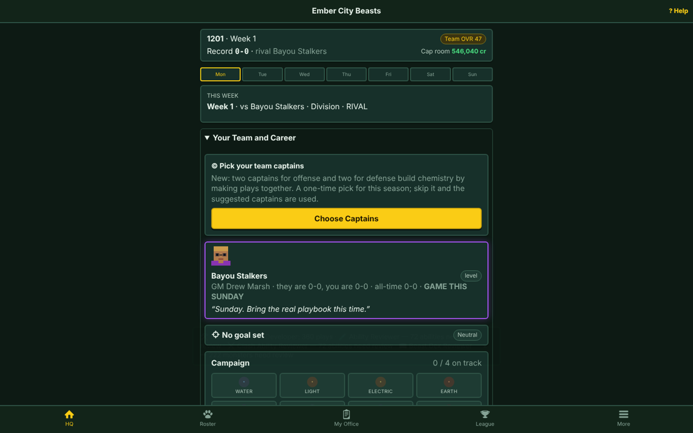
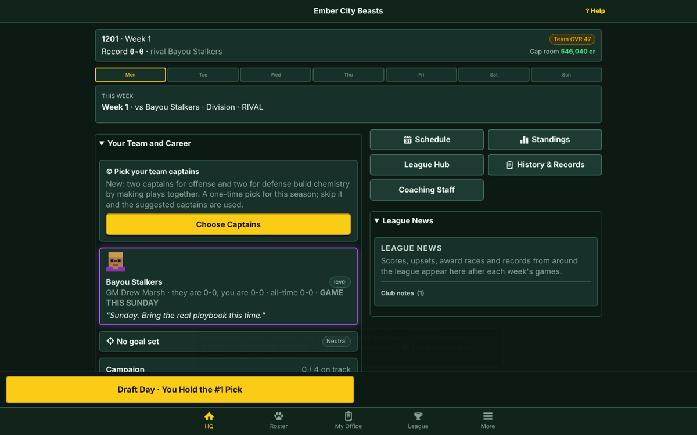
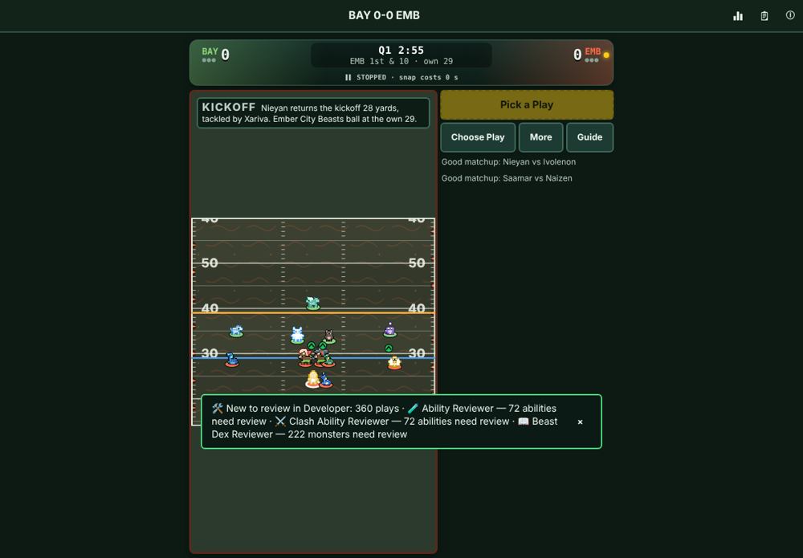
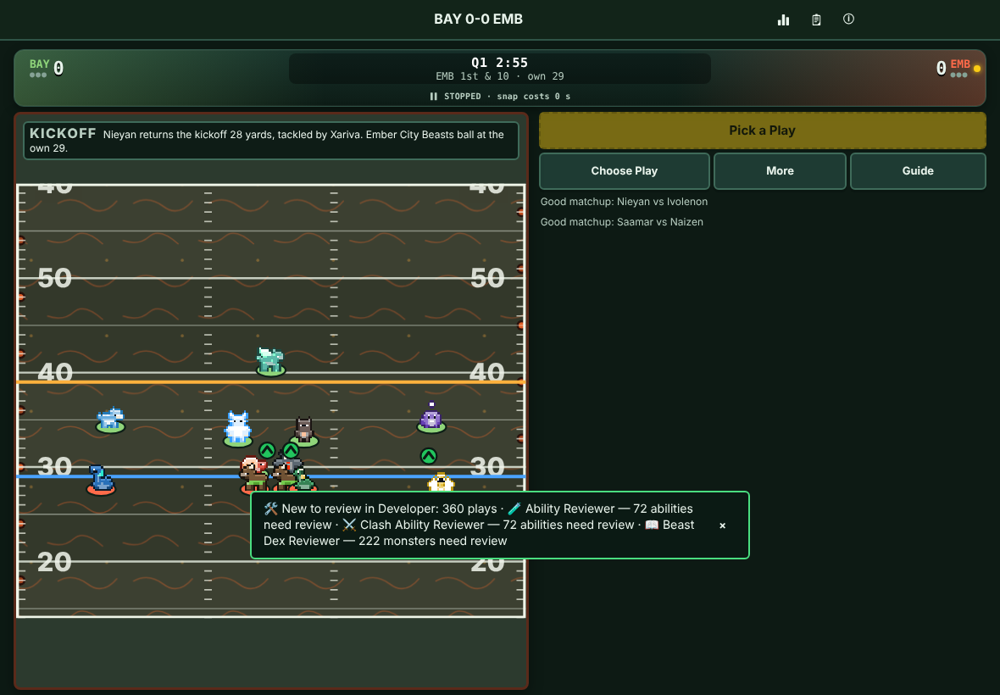
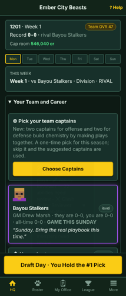
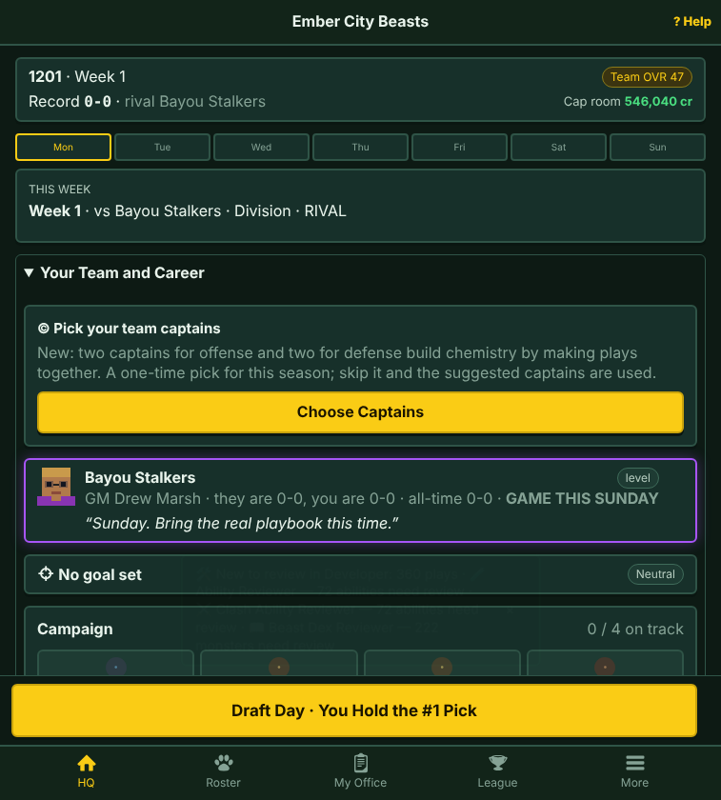
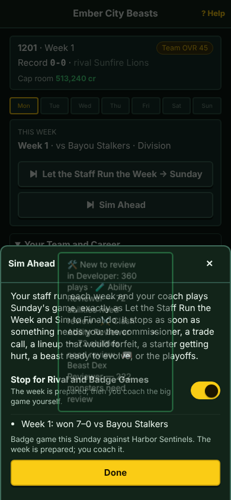

# Overnight update: phone bug fixes, large screens, device-wide display settings, Sim Ahead

Branch `claude/large-screens-overnight`, from main `986e202` (PR #150). Build **v43.37.0-large-screens**. Nothing is merged, deployed or installed: write access to GitHub was not available in this session, so the branch is delivered as a git bundle and a patch series.

Five code commits, plus this document:

| Commit | What |
| --- | --- |
| `68120f6` | Five phone bugs found in a real browser run, with regression tests |
| `d61de6f` | Large screens: Galaxy Z Fold unfolded, tablets and computers |
| `d39864f` | Display and accessibility settings apply across franchises on the device |
| `6a26fe4` | Sim Ahead: run whole weeks until something needs the owner |
| `b8fd99b` | HQ navigation test expects the new section classes |

## 1. Five bugs found by running the browser checks

The last several PRs record that Chromium could not launch where they were built, so their browser checks never ran. They ran here (system Chrome, `CHROMIUM_EXECUTABLE=/usr/bin/google-chrome`). Five real defects on main:

1. **UI sounds threw "Illegal invocation" on every toast, confirmation and reward** (`src/audio/ui-sounds.js`, PR #150). `queueMicrotask` was stored as `this.defer` and called as a method; browsers require it unbound. The page error broke the rest of whatever handler raised the toast. Fixed with a wrapper; `tests/ui-sounds.test.js` emulates the browser's receiver check and fails on main.
2. **The toast's Undo and × buttons could not be tapped** (PR #133). `#toast` has `pointer-events: none` and nothing turned it back on. Now only the visible toast's buttons take taps; the rest of the toast still lets taps through.
3. **Lineup Undo always refused** ("The team has changed"). The lineup change is saved before Undo is offered, and the store stamps `f.savedAt` on every save, which the Undo guard counted as a team change. Save bookkeeping is excluded (`src/ui/phone-navigation.js`); `tests/phone-navigation.test.js` covers it.
4. **The beast card tour never showed its last tip (Statistics) on phones.** The page bottoms out before that section reaches the reading line. At the bottom of the page the first visible unseen section is now shown, in order (`src/ui/guided-week.js`); new test in `tests/guided-week.test.js`.
5. **The pinned HQ action was at the bottom of the page, not the screen** (PR #133's main QoL item). The screen's slide-in animation used `fill-mode: both`, which keeps an identity transform; a transformed ancestor becomes the containing block for `position: fixed`. Fill is now `backwards`. `tools/phone-navigation-check.py` now checks the button is on screen *before* scrolling (it only checked after scrolling to the end, which hid the bug).

## 2. Large screens: Z Fold, tablets, computers

Phones under 720 px wide are unchanged.

- The column widens to 860 px (1080 px from 1200 px wide); the top bar and tab bar line up with it.
- Sheets are centred dialogs from 720×600; bottom sheets stay on phones and short landscape.
- HQ uses two columns from 860 px: the week's activity across the top, the team story on the left, links, last game, trades and news on the right. Sections gained classes (`hq-team-story`, `hq-news`, `hq-last-game`, `hq-links`); content and order are unchanged.
- The pinned HQ action is centred (an inline button ignored auto margins and sat at the left edge on any screen over 720 px).
- The live match on a large landscape screen gets a wider console: the field goes from **365 px to 608–661 px** wide on tablets and computers. Portrait tablets and the unfolded Fold already get a 741–804 px field.
- `manifest.webmanifest` allows any orientation (was portrait only).

| Before (laptop, 1440×900) | After |
| --- | --- |
|  |  |
|  |  |

Fold cover screen and unfolded:  

**Folding mid-game.** `tools/large-screen-check.py` starts a match on the cover screen, plays a snap, then unfolds, turns sideways, folds and unfolds again. At every step the console fits with no page scroll, the game state (play count, RNG, score, ball, clock, possession) is unchanged, and the next play runs. The Clash arena already re-lays itself out on resize.

### Native app settings to check (not in this repository)

The repository holds the web game only; these live in the native projects on the Mac.

- **Android (Fold):** keep the main activity resizable and make sure its `android:configChanges` includes `screenSize|smallestScreenSize|screenLayout|orientation`, so folding resizes the WebView instead of restarting the activity (a restart reloads the page; saves are safe, but the player lands on the menu). Do not set `android:screenOrientation="portrait"`.
- **iPad:** list all four orientations under `UISupportedInterfaceOrientations~ipad` in Info.plist (iPad multitasking needs them).
- **iPhone:** portrait-only is still a reasonable choice there; the game works in landscape if you allow it.

## 3. Display settings follow the device

Reduce Motion, Reduce Flashes, Larger Supporting Text, Screen Shake and Frame Rate used to live only in each franchise: a new franchise started from the defaults, and a choice made on the menu with no franchise loaded was lost on the next launch. `src/ui/device-settings.js` keeps a device copy (localStorage, like the audio settings) and writes it into the loaded franchise's settings on load, so every screen that reads `f.settings` directly sees it and saves still carry it. The first franchise on a device seeds it, so existing players keep their choices. Game settings (quarter length, coaching mode, speeds) stay per franchise. Settings shows "These display settings apply across franchises on this device." Browser-checked: a menu choice survives a reload and carries into a new franchise.

## 4. Sim Ahead

A **Sim Ahead** button on HQ, under Let the Staff Run the Week. The staff run each week and the coach plays Sunday's game, using only `autoRunToSunday`, `takeBye`, `simulatePlayerGame` and `finishSunday`. `tests/sim-ahead.test.js` shows a simmed week is byte-for-byte the week those steps produce by hand: nothing new is decided, rolled or recorded.

It stops for the commissioner, a season goal, a trade call, the creation draft, a live game, the playoffs, the end of the season and a lineup that would forfeit; after a game when a starter is newly hurt or a beast newly ready to evolve; and, by default (a remembered switch), on the Sunday of a rival or badge game with the week prepared, so the owner coaches the big games. The sheet offers **Sim Until I'm Needed** and **Sim 2 Weeks**, lists each result as it lands, saves after every week, can stop after the current week, and ends with why it stopped. It is hidden and blocked during the guided first week.

Each week takes about as long as a normal Sunday's league update (2–4 s on a laptop, mostly `finishSunday`), so a full regular season is roughly half a minute there, longer on a phone. The sheet shows progress the whole time.

**Owner decisions:** the stop list above, the default of stopping for rival and badge games, and whether evolution-ready should stop the run.

## 5. Browser checks that are out of date (not game bugs)

Updated here, because the game changed on purpose since they last ran: `franchise-polish-check.py` (PR #147's second point confirmation, PR #148's folded roster search), `guided-week-check.py` (toasts now queue, PR #133; sections scrolled to the reading line as a player would).

Still out of date, left for whoever owns them:

- `navigation-check.py` #8 expects tabs to open at the top; PR #133 made tabs remember their place on purpose.
- `tests/ui/responsive.py` expects 72 species cells and 21 achievements; the game now has 222 and more.
- `feature-ui-check.py` legendary counts (5 vs 6) and a leftover halftime sheet from its own shortcut.
- `coaching-gm-ui-check.py`, `individual-names-check.py`, `type-ui-check.py`: controls moved into sheets or folded sections (PR #136, #148).
- `problem-recorder-check.py` asserts an old build string; `roster-nav`, `injury-ui`, `evolution-ui`, `captains-ui`, `fa-ui`, `clash-continuous`, `trade-desk`, `league-hub`, `trade-deadline` need save files or arguments made by other tools; `storage-check.py` needs a closer look.

## Validation

- Passing in Chrome after all changes: `phone-navigation-check` (320/390/440 px and 844×390), `franchise-polish-check`, `guided-week-check`, `live-console-check`, `final-whistle-check`, `pregame-draft-check`, and the new `large-screen-check` (Fold cover 384×897, Fold open 757×840 and 840×757, tablet 820×1180 and 1180×820, 1440×900, 1920×1080).
- New and changed unit tests: `ui-sounds`, `phone-navigation`, `guided-week`, `device-settings`, `sim-ahead`, with the release stamp and central-text tests.
- **Full suite** (`npm test`, nothing else heavy running) on `6a26fe4`: **2,416 tests, 2,410 passed, 6 failed, 0 cancelled, 0 skipped, 84 min 27 s.**
  - 1 was this branch's: `hq-navigation` matched HQ markup exactly and the large-screen layout added section classes. Fixed in `b8fd99b`; the file passes (4/4).
  - **5 fail identically on main `986e202`** (each re-run there), so they predate this work:
    - `career-timeline` "development: evolutions as they happen…" (expects 'Lenrivin', gets 'Blazynx').
    - `franchise` "a new franchise has a legal roster…" and "save round-trips and the legacy v5 import…" (old individual names such as Zappard and Pyronix; most likely PR #141's separate beast names).
    - `final-whistle-qb-reads` "every in-game QB read display goes through the gate…" (a source-text pattern in `match.js` no longer matches).
    - `lifecycle-flows` "export and import: … the archive stays read-only" ("This franchise is retired: it is a read-only archive").
- Not done: a real Galaxy Z Fold, iPhone or iPad. Browser emulation does not prove the hinge, Android activity restarts, native safe areas or real touch.
