# Basic families: index

[Back to Beast Dex](README.md) · [Art review guide](art/REVIEW_GUIDE.md) · [Creation brief](BASIC_CREATION_BRIEF.md)

120 standalone Basic families, one per type and position. All are pending owner art/content review.

| Art | Family | ID | Type | Position | Clash archetype | Strength | Weaknesses | Review |
| --- | --- | --- | --- | --- | --- | --- | --- | --- |
|  | [Kindlet](families/kindlet.md) | `kindlet` | Fire | QB | Support | Accuracy | Arm, Durability | pending owner art/content review |
| 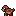 | [Charbun](families/charbun.md) | `charbun` | Fire | RB | Striker | Speed | Strength, Catching | pending owner art/content review |
|  | [Sparkwick](families/sparkwick.md) | `sparkwick` | Fire | WR | Disruptor | Speed | Catching, Awareness | pending owner art/content review |
|  | [Coalump](families/coalump.md) | `coalump` | Fire | TE | Tank | Strength | Speed, Awareness | pending owner art/content review |
| 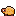 | [Kilnback](families/kilnback.md) | `kilnback` | Fire | OL | Balanced | Strength | Awareness, Agility | pending owner art/content review |
|  | [Scorchub](families/scorchub.md) | `scorchub` | Fire | DL | Striker | Speed | Awareness, Durability | pending owner art/content review |
| 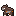 | [Embadger](families/embadger.md) | `embadger` | Fire | LB | Tank | Tackling | Coverage, Awareness | pending owner art/content review |
| 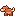 | [Singecat](families/singecat.md) | `singecat` | Fire | CB | Disruptor | Speed | Awareness, Catching | pending owner art/content review |
| 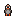 | [Ashpeck](families/ashpeck.md) | `ashpeck` | Fire | S | Balanced | Tackling | Coverage, Catching | pending owner art/content review |
| 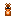 | [Fusebug](families/fusebug.md) | `fusebug` | Fire | K | Support | Kicking | Durability | pending owner art/content review |
|  | [Brookit](families/brookit.md) | `brookit` | Water | QB | Balanced | Awareness | Arm, Strength | pending owner art/content review |
| 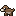 | [Ottrip](families/ottrip.md) | `ottrip` | Water | RB | Disruptor | Agility | Strength, Blocking | pending owner art/content review |
|  | [Minnodart](families/minnodart.md) | `minnodart` | Water | WR | Striker | Catching | Speed, Strength | pending owner art/content review |
| 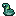 | [Kelpup](families/kelpup.md) | `kelpup` | Water | TE | Support | Catching | Strength, Blocking | pending owner art/content review |
|  | [Barnaclod](families/barnaclod.md) | `barnaclod` | Water | OL | Tank | Agility | Strength, Tackling | pending owner art/content review |
|  | [Sploshog](families/sploshog.md) | `sploshog` | Water | DL | Balanced | Agility | Strength, Tackling | pending owner art/content review |
| 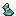 | [Newtide](families/newtide.md) | `newtide` | Water | LB | Support | Coverage | Strength, Tackling | pending owner art/content review |
|  | [Pondskip](families/pondskip.md) | `pondskip` | Water | CB | Striker | Agility | Strength, Tackling | pending owner art/content review |
|  | [Wadelet](families/wadelet.md) | `wadelet` | Water | S | Disruptor | Coverage | Strength, Tackling | pending owner art/content review |
|  | [Bubblop](families/bubblop.md) | `bubblop` | Water | K | Tank | Kicking | Awareness | pending owner art/content review |
| 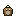 | [Acornet](families/acornet.md) | `acornet` | Nature | QB | Tank | Durability | Speed, Arm | pending owner art/content review |
| 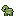 | [Thistlehop](families/thistlehop.md) | `thistlehop` | Nature | RB | Support | Durability | Speed, Catching | pending owner art/content review |
|  | [Fernflit](families/fernflit.md) | `fernflit` | Nature | WR | Balanced | Blocking | Speed, Agility | pending owner art/content review |
|  | [Stumpkin](families/stumpkin.md) | `stumpkin` | Nature | TE | Disruptor | Blocking | Speed, Catching | pending owner art/content review |
| 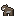 | [Trunkle](families/trunkle.md) | `trunkle` | Nature | OL | Support | Durability | Speed, Agility | pending owner art/content review |
| 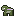 | [Briarhog](families/briarhog.md) | `briarhog` | Nature | DL | Tank | Durability | Speed, Agility | pending owner art/content review |
| 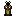 | [Barkbug](families/barkbug.md) | `barkbug` | Nature | LB | Striker | Durability | Speed, Coverage | pending owner art/content review |
| 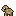 | [Fawnleaf](families/fawnleaf.md) | `fawnleaf` | Nature | CB | Balanced | Tackling | Speed, Catching | pending owner art/content review |
| 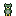 | [Ivyowl](families/ivyowl.md) | `ivyowl` | Nature | S | Striker | Durability | Speed, Catching | pending owner art/content review |
|  | [Podling](families/podling.md) | `podling` | Nature | K | Disruptor | Kicking | Speed | pending owner art/content review |
| 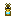 | [Ampette](families/ampette.md) | `ampette` | Electric | QB | Striker | Speed | Accuracy, Durability | pending owner art/content review |
| 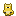 | [Fuzzvolt](families/fuzzvolt.md) | `fuzzvolt` | Electric | RB | Balanced | Speed | Strength, Durability | pending owner art/content review |
|  | [Boltdart](families/boltdart.md) | `boltdart` | Electric | WR | Support | Speed | Strength, Blocking | pending owner art/content review |
|  | [Wattram](families/wattram.md) | `wattram` | Electric | TE | Striker | Speed | Blocking, Strength | pending owner art/content review |
| 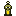 | [Capaclod](families/capaclod.md) | `capaclod` | Electric | OL | Disruptor | Speed | Strength, Durability | pending owner art/content review |
|  | [Zaphog](families/zaphog.md) | `zaphog` | Electric | DL | Support | Speed | Strength, Durability | pending owner art/content review |
| 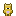 | [Staticub](families/staticub.md) | `staticub` | Electric | LB | Balanced | Speed | Strength, Coverage | pending owner art/content review |
| 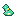 | [Neonnewt](families/neonnewt.md) | `neonnewt` | Electric | CB | Tank | Speed | Strength, Tackling | pending owner art/content review |
| 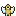 | [Buzzhawk](families/buzzhawk.md) | `buzzhawk` | Electric | S | Tank | Speed | Strength, Tackling | pending owner art/content review |
|  | [Wattlet](families/wattlet.md) | `wattlet` | Electric | K | Disruptor | Kicking | Durability | pending owner art/content review |
|  | [Slatelet](families/slatelet.md) | `slatelet` | Earth | QB | Disruptor | Strength | Speed, Agility | pending owner art/content review |
| 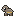 | [Gravelpup](families/gravelpup.md) | `gravelpup` | Earth | RB | Tank | Blocking | Speed, Agility | pending owner art/content review |
| 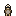 | [Mudlark](families/mudlark.md) | `mudlark` | Earth | WR | Tank | Strength | Speed, Agility | pending owner art/content review |
| 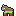 | [Clodhorn](families/clodhorn.md) | `clodhorn` | Earth | TE | Balanced | Blocking | Agility, Catching | pending owner art/content review |
| 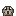 | [Cobblump](families/cobblump.md) | `cobblump` | Earth | OL | Striker | Blocking | Speed, Agility | pending owner art/content review |
| 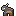 | [Quarrox](families/quarrox.md) | `quarrox` | Earth | DL | Disruptor | Strength | Agility, Tackling | pending owner art/content review |
| 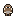 | [Diggit](families/diggit.md) | `diggit` | Earth | LB | Support | Strength | Speed, Coverage | pending owner art/content review |
| 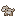 | [Pumicat](families/pumicat.md) | `pumicat` | Earth | CB | Support | Strength | Speed, Agility | pending owner art/content review |
|  | [Siltadillo](families/siltadillo.md) | `siltadillo` | Earth | S | Balanced | Strength | Speed, Coverage | pending owner art/content review |
|  | [Geodot](families/geodot.md) | `geodot` | Earth | K | Striker | Kicking | Awareness | pending owner art/content review |
|  | [Chillip](families/chillip.md) | `chillip` | Ice | QB | Striker | Accuracy | Speed, Strength | pending owner art/content review |
|  | [Skiddle](families/skiddle.md) | `skiddle` | Ice | RB | Tank | Awareness | Speed, Catching | pending owner art/content review |
|  | [Snowdart](families/snowdart.md) | `snowdart` | Ice | WR | Disruptor | Awareness | Speed, Strength | pending owner art/content review |
|  | [Walrump](families/walrump.md) | `walrump` | Ice | TE | Striker | Awareness | Speed, Agility | pending owner art/content review |
|  | [Floebear](families/floebear.md) | `floebear` | Ice | OL | Balanced | Awareness | Speed, Strength | pending owner art/content review |
|  | [Rimeboar](families/rimeboar.md) | `rimeboar` | Ice | DL | Tank | Tackling | Speed, Agility | pending owner art/content review |
|  | [Hoarcub](families/hoarcub.md) | `hoarcub` | Ice | LB | Disruptor | Coverage | Strength, Speed | pending owner art/content review |
|  | [Shiverkit](families/shiverkit.md) | `shiverkit` | Ice | CB | Balanced | Coverage | Speed, Strength | pending owner art/content review |
|  | [Ptarmilet](families/ptarmilet.md) | `ptarmilet` | Ice | S | Support | Awareness | Speed, Agility | pending owner art/content review |
|  | [Cubeling](families/cubeling.md) | `cubeling` | Ice | K | Striker | Kicking | Durability | pending owner art/content review |
|  | [Breezle](families/breezle.md) | `breezle` | Wind | QB | Support | Agility | Strength, Durability | pending owner art/content review |
|  | [Whirlhare](families/whirlhare.md) | `whirlhare` | Wind | RB | Striker | Agility | Blocking, Durability | pending owner art/content review |
|  | [Kitelet](families/kitelet.md) | `kitelet` | Wind | WR | Balanced | Agility | Strength, Durability | pending owner art/content review |
|  | [Sailmoth](families/sailmoth.md) | `sailmoth` | Wind | TE | Tank | Agility | Strength, Durability | pending owner art/content review |
|  | [Nimbulk](families/nimbulk.md) | `nimbulk` | Wind | OL | Tank | Agility | Strength, Tackling | pending owner art/content review |
|  | [Galebuck](families/galebuck.md) | `galebuck` | Wind | DL | Striker | Agility | Strength, Awareness | pending owner art/content review |
| 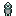 | [Windrook](families/windrook.md) | `windrook` | Wind | LB | Balanced | Agility | Strength, Tackling | pending owner art/content review |
| 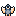 | [Swallit](families/swallit.md) | `swallit` | Wind | CB | Support | Agility | Strength, Durability | pending owner art/content review |
| 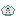 | [Pinwhirl](families/pinwhirl.md) | `pinwhirl` | Wind | S | Disruptor | Agility | Strength, Tackling | pending owner art/content review |
|  | [Gustpuff](families/gustpuff.md) | `gustpuff` | Wind | K | Tank | Kicking | Durability | pending owner art/content review |
|  | [Murkit](families/murkit.md) | `murkit` | Dark | QB | Disruptor | Awareness | Arm, Speed | pending owner art/content review |
| 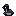 | [Minkurk](families/minkurk.md) | `minkurk` | Dark | RB | Striker | Awareness | Strength, Catching | pending owner art/content review |
| 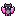 | [Batwhisk](families/batwhisk.md) | `batwhisk` | Dark | WR | Support | Agility | Blocking, Catching | pending owner art/content review |
|  | [Gloamtoad](families/gloamtoad.md) | `gloamtoad` | Dark | TE | Balanced | Catching | Blocking, Durability | pending owner art/content review |
|  | [Umbruin](families/umbruin.md) | `umbruin` | Dark | OL | Tank | Awareness | Durability, Strength | pending owner art/content review |
| 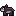 | [Vexhound](families/vexhound.md) | `vexhound` | Dark | DL | Disruptor | Awareness | Strength, Durability | pending owner art/content review |
| 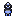 | [Crowlurk](families/crowlurk.md) | `crowlurk` | Dark | LB | Striker | Awareness | Strength, Durability | pending owner art/content review |
| 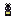 | [Spindlet](families/spindlet.md) | `spindlet` | Dark | CB | Tank | Awareness | Speed, Tackling | pending owner art/content review |
|  | [Gloomoth](families/gloomoth.md) | `gloomoth` | Dark | S | Support | Catching | Tackling, Durability | pending owner art/content review |
|  | [Inklet](families/inklet.md) | `inklet` | Dark | K | Balanced | Kicking | Speed | pending owner art/content review |
|  | [Beamlet](families/beamlet.md) | `beamlet` | Light | QB | Tank | Accuracy | Agility, Durability | pending owner art/content review |
|  | [Glowhare](families/glowhare.md) | `glowhare` | Light | RB | Support | Catching | Strength, Blocking | pending owner art/content review |
|  | [Dawnfinch](families/dawnfinch.md) | `dawnfinch` | Light | WR | Striker | Catching | Strength, Durability | pending owner art/content review |
|  | [Lanternox](families/lanternox.md) | `lanternox` | Light | TE | Disruptor | Awareness | Strength, Speed | pending owner art/content review |
|  | [Waxwick](families/waxwick.md) | `waxwick` | Light | OL | Support | Awareness | Speed, Tackling | pending owner art/content review |
|  | [Solram](families/solram.md) | `solram` | Light | DL | Balanced | Awareness | Speed, Strength | pending owner art/content review |
|  | [Lumbear](families/lumbear.md) | `lumbear` | Light | LB | Tank | Catching | Strength, Tackling | pending owner art/content review |
|  | [Glarefly](families/glarefly.md) | `glarefly` | Light | CB | Striker | Catching | Strength, Tackling | pending owner art/content review |
|  | [Dazzlet](families/dazzlet.md) | `dazzlet` | Light | S | Balanced | Awareness | Strength, Speed | pending owner art/content review |
|  | [Twinklet](families/twinklet.md) | `twinklet` | Light | K | Disruptor | Kicking | Strength | pending owner art/content review |
|  | [Rivetto](families/rivetto.md) | `rivetto` | Metal | QB | Balanced | Durability | Agility, Speed | pending owner art/content review |
|  | [Tinhare](families/tinhare.md) | `tinhare` | Metal | RB | Tank | Durability | Agility, Catching | pending owner art/content review |
|  | [Springlet](families/springlet.md) | `springlet` | Metal | WR | Disruptor | Durability | Agility, Speed | pending owner art/content review |
| 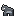 | [Anvilox](families/anvilox.md) | `anvilox` | Metal | TE | Support | Durability | Speed, Agility | pending owner art/content review |
|  | [Kettlump](families/kettlump.md) | `kettlump` | Metal | OL | Striker | Durability | Awareness, Agility | pending owner art/content review |
| 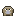 | [Ingotusk](families/ingotusk.md) | `ingotusk` | Metal | DL | Support | Strength | Agility, Speed | pending owner art/content review |
| 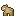 | [Brasshound](families/brasshound.md) | `brasshound` | Metal | LB | Disruptor | Durability | Agility, Catching | pending owner art/content review |
| 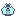 | [Gyroflit](families/gyroflit.md) | `gyroflit` | Metal | CB | Balanced | Durability | Agility, Catching | pending owner art/content review |
|  | [Clockcrow](families/clockcrow.md) | `clockcrow` | Metal | S | Striker | Durability | Agility, Catching | pending owner art/content review |
|  | [Washerling](families/washerling.md) | `washerling` | Metal | K | Tank | Kicking | Agility | pending owner art/content review |
|  | [Mindle](families/mindle.md) | `mindle` | Psychic | QB | Support | Awareness | Durability, Strength | pending owner art/content review |
|  | [Dreamhop](families/dreamhop.md) | `dreamhop` | Psychic | RB | Disruptor | Catching | Durability, Strength | pending owner art/content review |
| 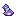 | [Trancefin](families/trancefin.md) | `trancefin` | Psychic | WR | Tank | Awareness | Strength, Blocking | pending owner art/content review |
| 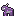 | [Pondermoose](families/pondermoose.md) | `pondermoose` | Psychic | TE | Striker | Catching | Durability, Strength | pending owner art/content review |
|  | [Thinkump](families/thinkump.md) | `thinkump` | Psychic | OL | Disruptor | Awareness | Strength, Tackling | pending owner art/content review |
|  | [Omenox](families/omenox.md) | `omenox` | Psychic | DL | Balanced | Awareness | Strength, Tackling | pending owner art/content review |
| 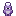 | [Seerling](families/seerling.md) | `seerling` | Psychic | LB | Balanced | Awareness | Strength, Speed | pending owner art/content review |
| 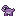 | [Riddlet](families/riddlet.md) | `riddlet` | Psychic | CB | Support | Coverage | Strength, Durability | pending owner art/content review |
| 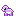 | [Gazeling](families/gazeling.md) | `gazeling` | Psychic | S | Tank | Coverage | Strength, Durability | pending owner art/content review |
|  | [Orblet](families/orblet.md) | `orblet` | Psychic | K | Striker | Kicking | Strength | pending owner art/content review |
|  | [Scalekin](families/scalekin.md) | `scalekin` | Dragon | QB | Striker | Arm | Agility, Accuracy | pending owner art/content review |
| 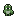 | [Raptlet](families/raptlet.md) | `raptlet` | Dragon | RB | Balanced | Speed | Awareness, Catching | pending owner art/content review |
| 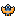 | [Glidrake](families/glidrake.md) | `glidrake` | Dragon | WR | Tank | Speed | Awareness, Durability | pending owner art/content review |
| 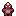 | [Crestback](families/crestback.md) | `crestback` | Dragon | TE | Support | Strength | Awareness, Catching | pending owner art/content review |
| 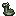 | [Bulwyrm](families/bulwyrm.md) | `bulwyrm` | Dragon | OL | Disruptor | Strength | Awareness, Speed | pending owner art/content review |
|  | [Gnashlet](families/gnashlet.md) | `gnashlet` | Dragon | DL | Striker | Tackling | Agility, Awareness | pending owner art/content review |
|  | [Drakhound](families/drakhound.md) | `drakhound` | Dragon | LB | Tank | Tackling | Coverage, Catching | pending owner art/content review |
|  | [Wyvlet](families/wyvlet.md) | `wyvlet` | Dragon | CB | Disruptor | Tackling | Coverage, Catching | pending owner art/content review |
|  | [Skinklet](families/skinklet.md) | `skinklet` | Dragon | S | Support | Speed | Awareness, Catching | pending owner art/content review |
|  | [Eggling](families/eggling.md) | `eggling` | Dragon | K | Balanced | Kicking | Accuracy | pending owner art/content review |
