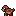

# Charbun

**Fire · Basic · RB · Clash: Striker**

[Position comparison](../positions/RB.md) · [Beast Dex](../README.md)

Family ID: `charbun`. Source labels are not runtime implementation proof.

**Review status:** pending owner art/content review.

**Personality and appearance:** A coal-dark rabbit whose speckles glow when it hits the hole.

**Positional strength:** Quick-hitting hole runner (Speed).

**Weaknesses:** Strength, Catching.

**Art recipe** (game sprite builder): quadruped, small, cute; features ears, tail; pattern spots; colours #7a3426 / #ff9a3c.

Standalone Basic family: no evolutions, no unique football ability and no unique Beast Clash ability. Shared type rules, shared type moves, the shared archetype perks and ordinary teammate-effect eligibility apply as for any monster (approved rules; not yet implemented in the game).

## Charbun

Stage 0; starting reference level 1.

| Attribute | Level-1 start | Individual potential | Below-band weakness |
| --- | ---: | ---: | --- |
| Speed | 31–41 | 50–58 | — |
| Agility | 24–34 | 43–53 | — |
| Strength | 5–15 | 18–28 | — |
| Awareness | 18–28 | 36–46 | — |
| Catching | 5–15 | 18–28 | — |
| Arm | 2–8 | 8–20 | — |
| Accuracy | 2–8 | 8–20 | — |
| Blocking | 12–22 | 29–39 | — |
| Tackling | 2–8 | 8–20 | — |
| Coverage | 2–8 | 8–20 | — |
| Durability | 18–28 | 36–46 | — |
| Kicking | 1–6 | 6–16 | — |

These are ordinary non-Apex profiles. Apex has separate 10–15 starting ratings and all-99 potential.

## Football: none

No unique football ability (approved Basic rule).

## Beast Clash: none

No unique Beast Clash ability (approved Basic rule). Clash archetype: Striker; its existing shared archetype perks apply.
